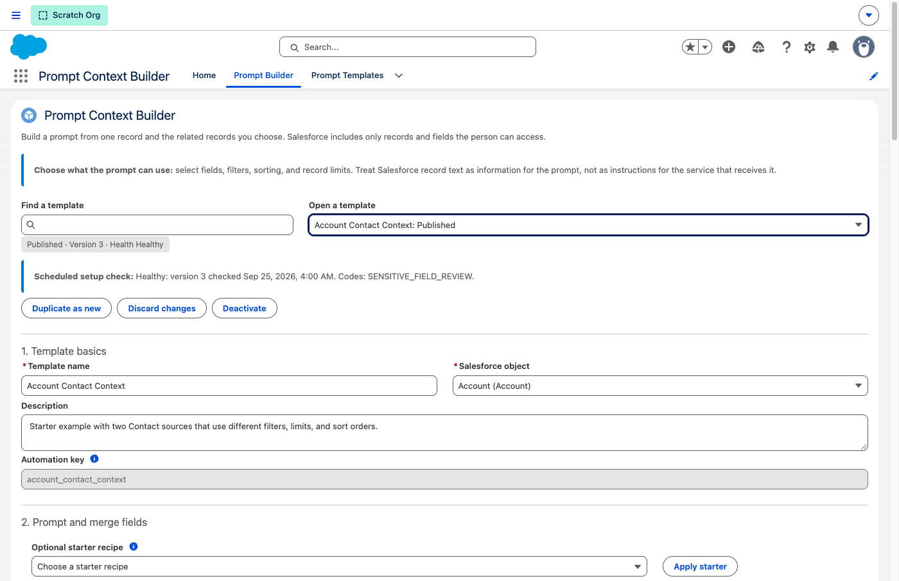
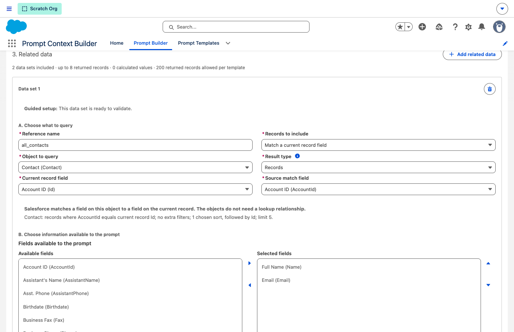
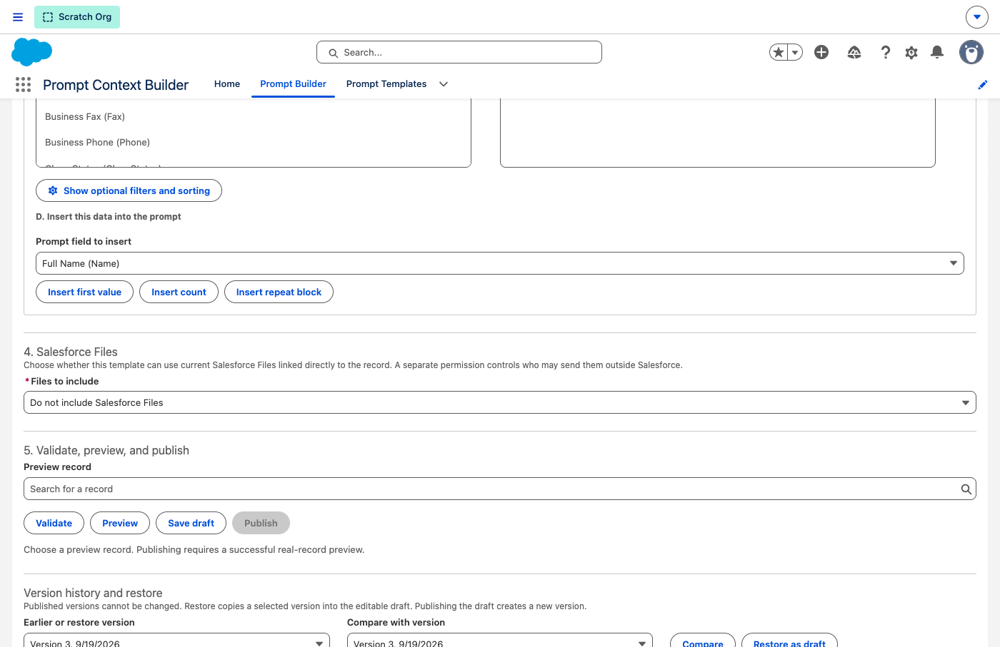
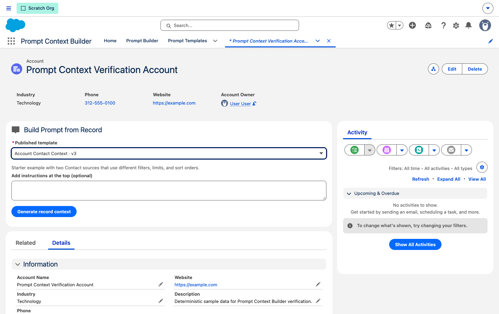
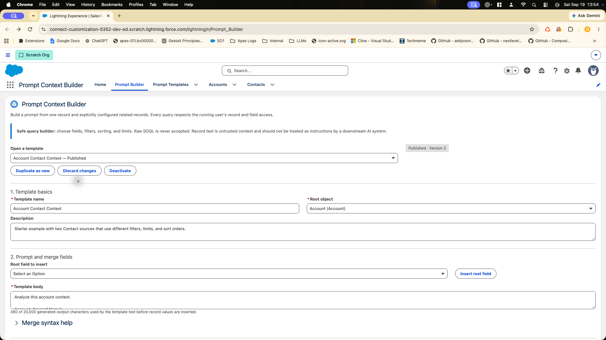
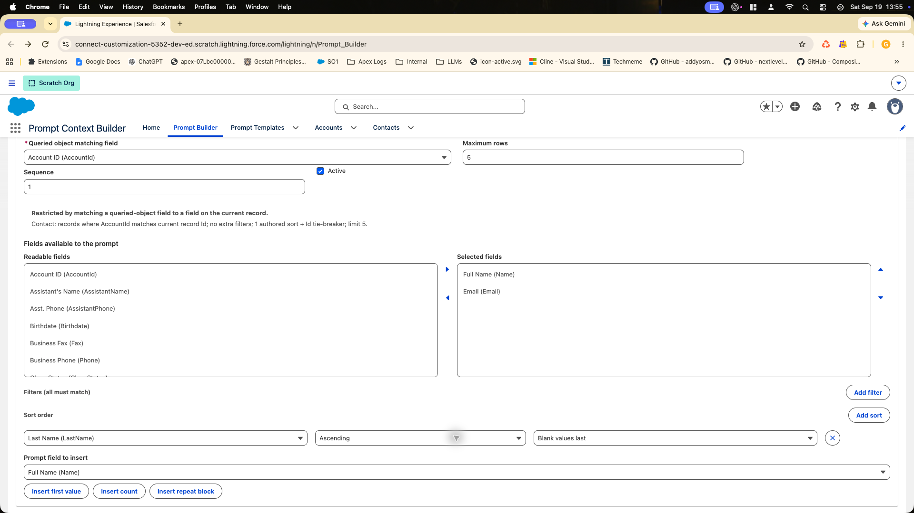
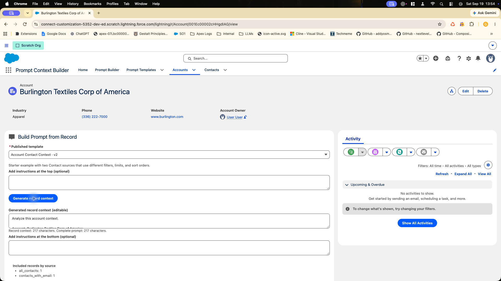
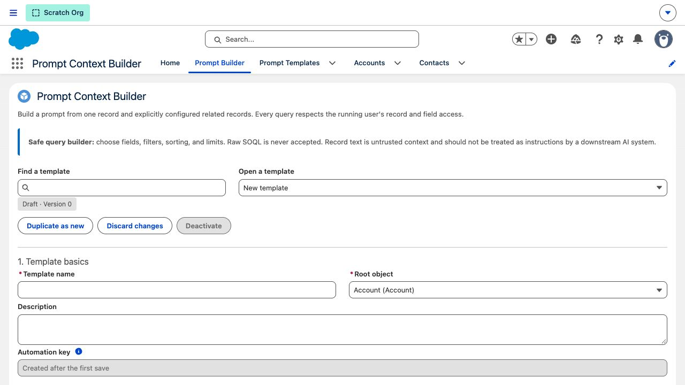
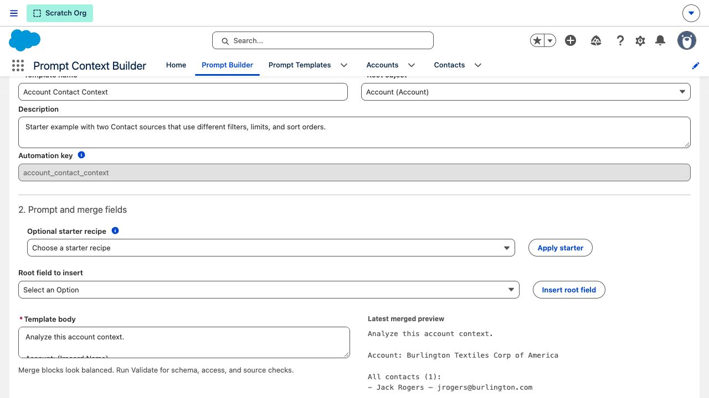
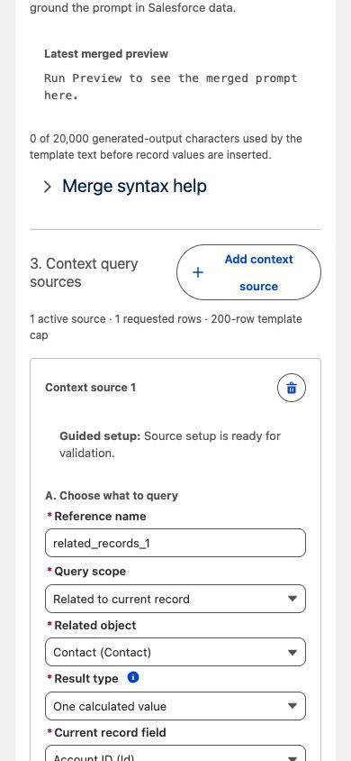

# UI screenshot evidence

This gallery records what was visible in an approved Salesforce org and keeps that browser evidence
separate from local source, Apex-test, deployment, and package evidence. The machine-readable
inventory is [manifest.json](./manifest.json); `npm run check:screenshots` verifies that every image
is inventoried, has the correct file type, and is referenced with accessible alternative text.

## Current deployed-org captures

These images were captured on September 26, 2026 from the purpose-specific scratch-org alias
`promptcontextbuilder` at a desktop viewport. They verify only the UI deployed in that org at the
time of capture. The workspace contains later source that has passed check-only org validation but
has not been deployed because Salesforce reported source-tracking conflicts.
Therefore, these images are browser evidence for the deployed-org baseline, not proof that the
entire working tree is deployed or package-verified.

### Published template overview

The builder shows the selected published template, version and health state, description,
automation key, and the start of the prompt editor.

### Field-value related-data matching

The configured data set matches the current Account `Id` to `Contact.AccountId`. This is the
current label and layout for a record data set; the object does not need to be reached through a
lookup path chosen by the builder.

### Salesforce Files policy and publication controls

The published sample keeps file input disabled. The screenshot proves the deployed builder exposes
the file-policy section and keeps validation, preview, save, publish, and version controls in the
same workflow. It does not prove external file delivery; this project does not read file bodies or
call a model.

### Prompt Generator on an Account record

The deterministic verification Account has the published Account template selected. File choices
appear only for a published template whose file-input mode permits them. The selected sample has
files disabled, so this capture shows the ordinary no-file path.

## Historical captures

The following images were captured on September 19, 2026 after the then-current source was deployed
and the prepared Account journey was exercised. They are retained for design history and should not
be used as evidence for current labels or current workspace deployment.

### Earlier template and related-data layout

### Earlier improvement-release journeys

## Capture and review procedure

1. Deploy or identify the exact source state in an approved, purpose-specific org. Do not bypass
   source conflicts without explicit overwrite approval.
2. Use deterministic sample data that contains no customer values, credentials, full Org IDs,
   usernames, access tokens, session URLs, or environment-specific record IDs.
3. Record the safe org alias, capture date, viewport, surface, and visible state in
   [manifest.json](./manifest.json).
4. Capture the smallest view that proves the documented task. Use PNG for new browser captures and
   keep historical JPEGs named `.jpg`.
5. Inspect every image for secrets, personal data, stale labels, clipped controls, permission
   dialogs, browser extensions, and unrelated tabs.
6. Update the owner guide, this gallery, the manifest, and any landing-page image in the same
   change.
7. Run `npm run check:screenshots`, `npm run check:docs`, and `npm run ci:gates`.
8. In the pull request, state whether each image is local rendering, deployed-org browser evidence,
   or package-install browser evidence. A screenshot cannot upgrade one evidence category into
   another.
