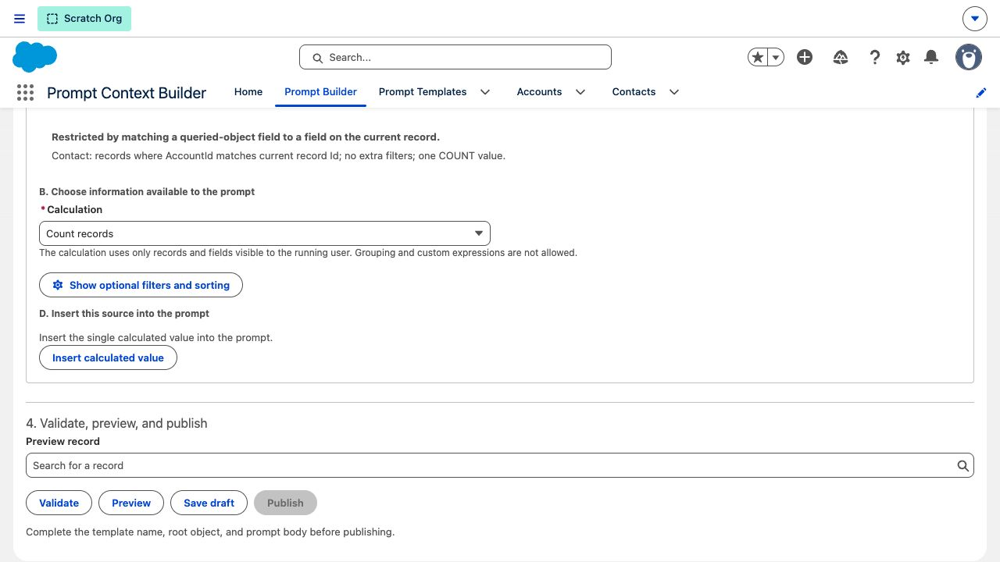
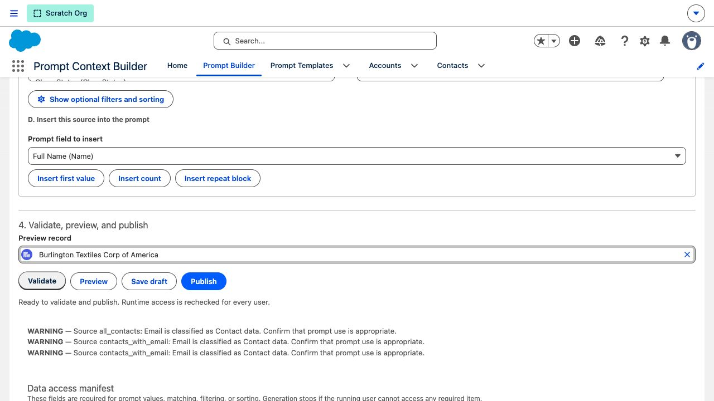
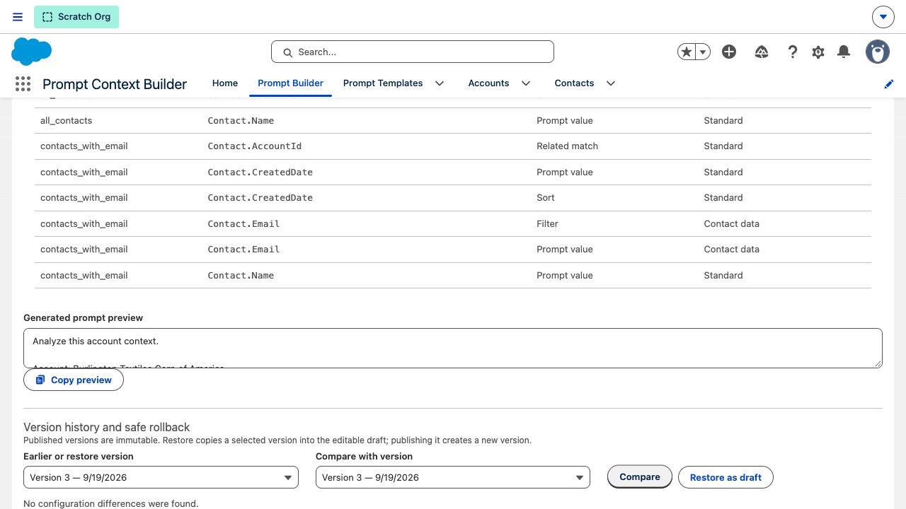
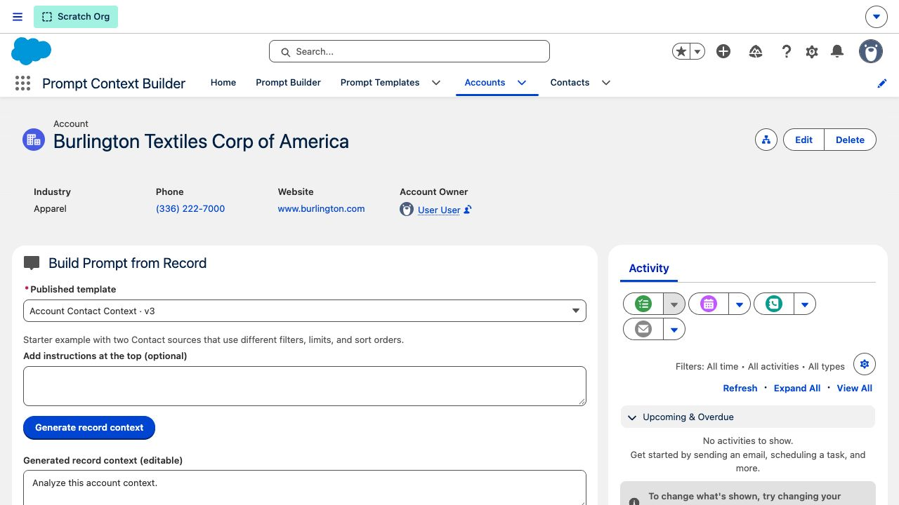

# Historical deployed UI screenshots

These images were captured from a dedicated scratch org after deployment and end-to-end prompt
generation on the seeded Account record on September 19, 2026. They verify that deployment and may
show wording that predates the September 22 plain-language revision. Fresh captures require the
project scratch org to be authenticated and the revised source to be deployed. Do not treat these
images as browser verification of the revised wording.

## Prompt Builder: template and merge syntax

## Prompt Builder: related data settings

## Prompt Generator: generated Account context

## Current improvement-release journeys

### Wide builder and curated object setup

### Calculated value

### Validation, classification warnings, and required field access

### Real-record merged preview

### Published version comparison

### Narrow 390-pixel layout

### Current prompt generation

The Account page is assigned only to the Prompt Context Builder app. The generated example shows
an editable 217-character context and the record count from each independently configured data set.
